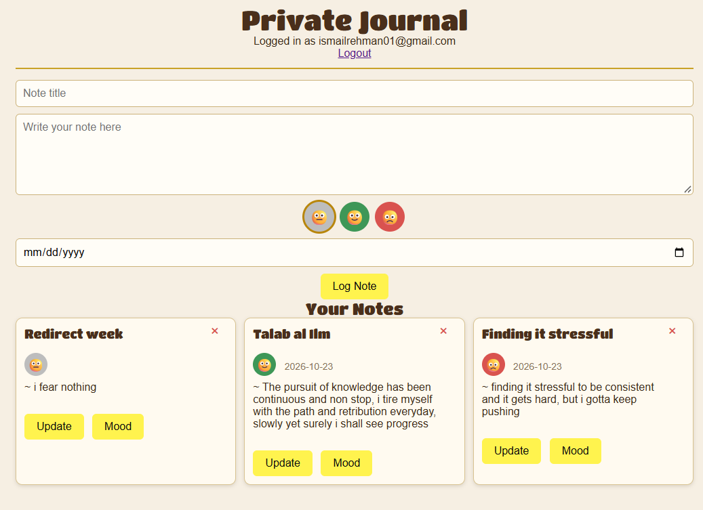

# Private Notes

A private journal app. Sign up, log in, and your notes are yours alone: every note is stamped with your account when it is saved, and every read, update, and delete checks that stamp before touching anything.

**Live site:** https://private-notes-ismail.onrender.com

## What it does

- Sign up and log in with a local account (passport-local, passwords hashed with bcrypt)
- Write journal entries with a title, the note itself, a mood, and a date
- Mood is a three-face picker: grey blank, green happy, red sad
- Update a note's text in place
- Change a note's mood with its own separate Mood button, it cycles one step per click
- Delete a note with the X in the top corner of its card
- Log out, log back in, your entries are still there and nobody else's are in sight

## Stack

- Node.js and Express for the server
- MongoDB Atlas for the database
- Mongoose for the user accounts, the native MongoDB driver for the notes (both tools, one app, on purpose)
- Passport for login sessions
- EJS for the pages
- Plain CSS, no framework: parchment and leather theme, golden buttons, responsive at three breakpoints

## How the interesting parts work

- The user stamp is data, not decoration. When a note is saved, the server adds the logged-in user's id to the document. Update and delete filters match on the note's id AND that stamp together, so a note can only ever be changed by its owner.
- Ids make a round trip. The browser only ever holds an id as plain text, so the server converts it back with new ObjectId() before asking MongoDB to match it. Text and ObjectId never compare equal, that one conversion is the difference between an update that lands and one that silently misses.
- Mood got its own route. PUT /notes changes the text, PUT /notes/mood changes only the mood. Two small jobs instead of one route doing double duty, and the front end works out the next mood in the cycle (blank to happy to sad to blank) before it calls.
- The login and signup buttons need no JavaScript at all. They are plain form submits; passport reads the email and password fields on the server. The note buttons are the ones that use fetch, so the page can update without a full reload of the form.

## Run it locally

1. Clone this repo
2. Run npm install
3. Make a .env file with your own Atlas string: DB_STRING=your-connection-string
4. Run node server.js
5. Open http://localhost:8020

App 2 of 3 in a series of Express CRUD apps. The first was Halal Eats (no auth, one collection, full CRUD). Next up: a workout log with auth, this time with a Mongoose model for the data.
